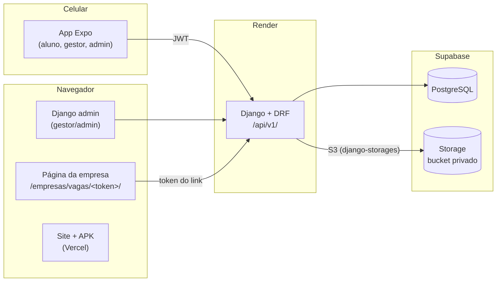
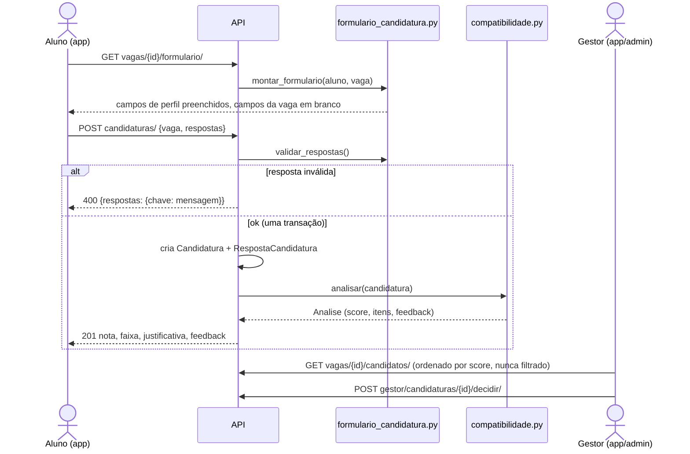

# Arquitetura · TEIA Currículo Sob Medida

Como as peças do sistema se encaixam, os fluxos principais e onde mexer para cada coisa.
Para os endpoints, veja [`api.md`](api.md). Para as tabelas, [`modelo-de-dados.md`](modelo-de-dados.md).

## Visão geral



- **Um backend só** (`backend/` + `solicitacoes/`) atende o app, o admin do Django e a
  página pública das empresas.
- **Empresa não tem login.** O gestor gera um link com token; a empresa preenche a vaga e
  o gestor revisa antes de publicar (`solicitacoes/`).
- **Arquivos nunca são públicos.** Currículos enviados ficam num bucket privado e só saem
  pela API, para o próprio aluno logado.
- Em dev tudo roda no Docker Compose (Postgres local, arquivos em `media/`).

## Perfis e permissões

| Perfil | Como nasce | O que acessa |
| --- | --- | --- |
| Aluno | auto-cadastro com e-mail institucional (`ALUNO_EMAIL_DOMINIOS`) e aceite LGPD | o próprio currículo, vagas abertas, as próprias candidaturas |
| Gestor do TEIA | criado pelo admin | vagas, candidatos, decisões, links para empresas |
| Admin | superusuário / perfil admin | cadastros (empresas, cursos, competências), usuários, resumo |

As regras ficam em `backend/api/permissions.py`. A mais importante é
`IsAlunoComConsentimento`: sem o termo LGPD vigente, o aluno não usa nada que trate o
currículo (perfil, formulário, candidaturas).

## Fluxo principal: candidatura



1. **Modelo da vaga.** Cada vaga tem um `ModeloCurriculo` com `CampoModelo`s. Campo de
   `perfil` aponta para um dado do aluno (`fonte_perfil`) e sai preenchido; campo da `vaga`
   sai em branco. Vaga sem modelo ganha um padrão (só campos de perfil) na primeira vez.
2. **Respostas.** Gravadas em `RespostaCandidatura`, uma por campo, com cópia de rótulo e
   origem. `editado = true` marca o campo de perfil que o aluno mudou antes de enviar.
3. **Análise.** `compatibilidade.analisar` avalia curso, semestre mínimo, competências
   (no perfil ou citadas em experiências e cursos) e idiomas. Score = requisitos com
   evidência ÷ total. Faixas: alta ≥ 75, média 50–74, baixa < 50 (provisórias).
4. **Reanálise.** `POST candidaturas/{id}/reanalisar/` gera uma análise nova com o
   currículo atual; as anteriores ficam no histórico (`perfil_snapshot` guarda o que foi usado).
5. **Decisão humana.** Só o gestor muda o status (`analisada → encaminhada → em_processo`
   ou `nao_selecionada`). Encaminhar cria o `Encaminhamento`; voltar para `analisada` desfaz.

## Outros fluxos

**Importar currículo (PDF/Word).** `POST me/perfil/arquivo/` guarda o arquivo,
`leitura_curriculo.py` extrai o texto e sugere formação, experiências, competências,
idiomas e cursos. O app mostra as sugestões e o aluno confirma em `POST me/perfil/importar/`.
Nada entra no perfil sem confirmação. A leitura é por regras, no servidor: o arquivo não
vai para serviços externos.

**Vaga enviada por empresa.** Gestor gera link (token mostrado uma vez; o banco guarda o
hash) → empresa preenche → gestor revisa no mesmo formulário de vaga → publica ou recusa.
Detalhes e regras de segurança em [`solicitacoes/README.md`](../solicitacoes/README.md).

## LGPD no código

- Aceite no cadastro, com versão do termo (`VERSAO_TERMO_LGPD`). Mudou o texto, suba a
  versão: todos precisam aceitar de novo.
- Aluno pode revogar em `me/consentimento/`. A partir daí o gestor vê `curriculo = null` e
  `respostas = null` nas candidaturas dele.
- Arquivo enviado com nome aleatório no storage (o nome original, que costuma ter o nome do
  aluno, fica só no banco). Apagar o registro apaga o arquivo.
- Nenhuma eliminação automática: a nota ordena, mas o gestor sempre vê todos.

## Onde mexer

| Quero... | Arquivo |
| --- | --- |
| mudar faixas da compatibilidade | `Analise.FAIXA_*` em `backend/models/vagas.py` **e** `frontend/src/utils/compatibilidade.ts` |
| mudar a regra do score / evidências | `backend/compatibilidade.py` (suba `VERSAO_MOTOR`) |
| criar um campo de perfil novo para o formulário | `CampoModelo.FontePerfil` em `backend/models/modelo_curriculo.py` + `FONTES` em `backend/formulario_candidatura.py` |
| mudar os campos padrão de uma vaga sem modelo | `CAMPOS_PERFIL_PADRAO` em `backend/formulario_candidatura.py` |
| mudar as perguntas das vagas de demonstração | `MODELOS_CURRICULO` em `backend/management/seed_dados.py` |
| melhorar a leitura de PDF/Word | `backend/leitura_curriculo.py` |
| criar um endpoint | `backend/api/views.py` + `serializers.py` + `urls.py`, documentar em `docs/api.md` |
| mudar quem acessa o quê | `backend/api/permissions.py` |
| mudar o visual do app | `frontend/src/constants/theme.ts` e `frontend/src/components/Ui/` (ver `DESIGN.md`) |
| mudar tipos da API no app | `frontend/src/types/index.ts` |
| configurar storage / banco / CORS | `config/settings.py` + `.env.example` + `render.yaml` |

## Testes

```bash
python manage.py test                              # tudo (backend + solicitacoes)
python manage.py test backend.tests.test_formulario  # um arquivo
```

| Arquivo | Cobre |
| --- | --- |
| `backend/tests/test_api.py` | cadastro, login, perfil, vagas, permissões (tem a `BaseAPITest`) |
| `backend/tests/test_candidaturas.py` | candidatura, análise por requisito, reanálise |
| `backend/tests/test_formulario.py` | faixas, justificativa, formulário da vaga, respostas, seed dos modelos |
| `backend/tests/test_gestao.py` | painel, ranking, decisão do gestor, administração |
| `backend/tests/test_importacao.py` | leitura de PDF/DOCX e importação de sugestões |
| `backend/tests/test_seed.py` | seed idempotente |
| `solicitacoes/tests.py`, `tests_api.py` | links de empresa, formulário público, publicação |

## Tarefas do time (2026.2)

Divisão combinada: **T0 + T2 backend** Hades · **T1 + T4** Tadeu · **T5 + T6** Ismael ·
**T3 + T2 frontend** Ana Vitória. Fluxo: uma branch por tarefa e PR para `01-backend`
revisado por outra pessoa. Combine as migrações antes.

| Tarefa | Status | Onde está / próximo passo |
| --- | --- | --- |
| **T0** Base: candidatura, compatibilidade, storage | ✅ pronto | Faixas 75/50 e `justificativa` na análise; Supabase Storage em `config/settings.py`. Falta: **confirmar as faixas com o TEIA** e preencher as variáveis `SUPABASE_*` no Render |
| **T1** Certificados do banco de atividades extras | ✅ upload pelo aluno · ⏳ banco da UNDB | Backend pronto: `Certificado` e `CandidaturaCertificado` (migração 0005), `me/certificados/`, `certificados` na candidatura e regra de compatibilidade `regras-0.3` (título cita a competência ou um sinônimo). Entrada pela camada `backend/importacao_certificados.py`, para trocar a origem depois. Falta: a tela de upload e encaixar `ListaCertificados` na candidatura (Ana Vitória) e descobrir se a UNDB oferece API ou exportação oficial: ver [`certificados-undb.md`](certificados-undb.md) |
| **T2** Modelo de currículo por vaga | ✅ backend · ⏳ frontend | Backend pronto: `modelo_curriculo.py`, `formulario_candidatura.py`, `GET vagas/{id}/formulario/`. Frontend: tipos e `buscarFormulario`/`candidatar(vaga, respostas)` já existem; falta a tela. Depois, tornar `respostas` obrigatório (`TODO` em `formulario_candidatura.validar_respostas`) |
| **T3** Limpar a UI | ⏳ em andamento | `constants/theme.ts`, `components/Ui/`, `DESIGN.md` |
| **T4** Painel admin web | ⏳ parcial | Admin do Django já tem vagas com requisitos, candidaturas com análises e respostas, modelos de currículo. Falta tema (unfold/jazzmin), permissões por perfil e tela de triagem. `TODO(T4)` em `backend/admin.py` |
| **T5** Importar currículo e autopreencher | ✅ fluxo implementado | PDF com texto e DOCX → sugestões → revisão → confirmação. O app oferece apagar original e texto após confirmação sem erros. PDFs escaneados e `.doc` não são aceitos. Certificados e sugestões para respostas específicas de vagas ficam para integração futura |
| **T6** Exportar currículo em PDF | ✅ implementado | `GET me/curriculo/pdf/`, ReportLab em memória com perfil atual, seleção de seções, download web e compartilhamento nativo. `backend/exportacao_curriculo.py` e `components/curriculo/ExportarCurriculo.tsx`. Certificados dependem da T1 |

Os `TODO(...)` no código indicam onde cada pessoa entra. Para listar:

```bash
grep -rn "TODO" backend solicitacoes config frontend/src
```
