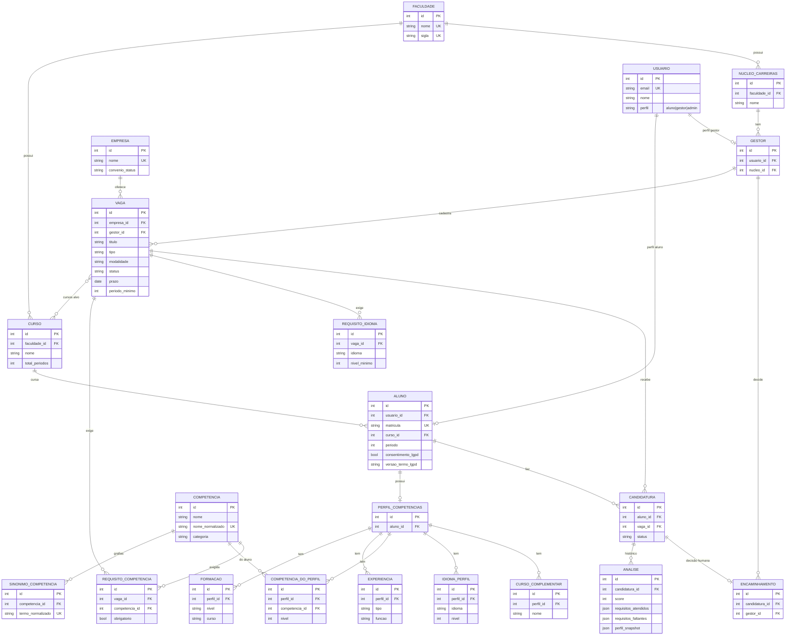

# Modelo de dados

21 models no app `backend`, organizados em 4 módulos. Nomes das tabelas no banco levam o
prefixo `backend_` (ex.: `backend_vaga`).

## Diagrama (campos principais)

## Dicionário de campos

Legenda: **PK** chave primária · **FK** chave estrangeira · **UK** único · `null` aceita nulo ·
`blank` pode ficar vazio no formulário. Todo model tem `id` (BigAutoField) como PK.

### Módulo `faculdade.py`

**Faculdade**

| Campo | Tipo | Regras |
| --- | --- | --- |
| nome | Char(150) | UK |
| sigla | Char(20) | UK |
| cidade | Char(100) | blank |
| uf | Char(2) | blank |

**Curso**

| Campo | Tipo | Regras |
| --- | --- | --- |
| faculdade | FK → Faculdade | PROTECT |
| nome | Char(150) | UK com faculdade |
| total_periodos | SmallInt ≥ 0 | padrão 10 |
| ativo | Bool | padrão True |

**NucleoCarreiras** (ex.: TEIA)

| Campo | Tipo | Regras |
| --- | --- | --- |
| faculdade | FK → Faculdade | PROTECT |
| nome | Char(100) | UK com faculdade |
| email_contato | Email | blank |

### Módulo `usuarios.py`

**Usuario** (`AbstractUser` sem `username`; login por e-mail)

| Campo | Tipo | Regras |
| --- | --- | --- |
| email | Email | UK, `USERNAME_FIELD`, salvo em minúsculas |
| nome | Char(150) | obrigatório (`REQUIRED_FIELDS`) |
| perfil | Char(10) | `aluno` · `gestor` · `admin`; padrão `aluno` |
| *herdados* | — | password, is_active, is_staff, is_superuser, last_login, date_joined, groups, user_permissions (first_name e last_name existem mas não são usados) |

**Aluno**

| Campo | Tipo | Regras |
| --- | --- | --- |
| usuario | OneToOne → Usuario | CASCADE; perfil do usuário deve ser `aluno` |
| matricula | Char(30) | UK |
| curso | FK → Curso | PROTECT |
| periodo | SmallInt | 1–20 e ≤ `curso.total_periodos` |
| consentimento_lgpd | Bool | padrão False |
| consentimento_lgpd_em | DateTime | null |
| versao_termo_lgpd | Char(10) | blank |
| criado_em / atualizado_em | DateTime | automáticos |

Métodos: `registrar_consentimento(aceito=True)` grava data e versão do termo;
`consentimento_vigente` é verdadeiro se aceito **e** na versão atual (`VERSAO_TERMO_LGPD`).

**Gestor** (criado só pela administração)

| Campo | Tipo | Regras |
| --- | --- | --- |
| usuario | OneToOne → Usuario | CASCADE; perfil do usuário deve ser `gestor` |
| nucleo | FK → NucleoCarreiras | PROTECT |
| cargo | Char(100) | blank |
| criado_em | DateTime | automático |

### Módulo `curriculo.py`

**Competencia** (vocabulário compartilhado)

| Campo | Tipo | Regras |
| --- | --- | --- |
| nome | Char(100) | — |
| nome_normalizado | Char(100) | UK, calculado no `save()` (sem acento, minúsculas) |
| categoria | Char(15) | `tecnica` · `ferramenta` · `comportamental`; padrão `tecnica` |
| ativa | Bool | padrão True |

`Competencia.resolver(texto)` busca por nome ou sinônimo normalizado.

**SinonimoCompetencia**

| Campo | Tipo | Regras |
| --- | --- | --- |
| competencia | FK → Competencia | CASCADE, `related_name="sinonimos"` |
| termo | Char(100) | — |
| termo_normalizado | Char(100) | UK; não pode coincidir com o nome de outra competência |

**PerfilCompetencias**

| Campo | Tipo | Regras |
| --- | --- | --- |
| aluno | OneToOne → Aluno | CASCADE |
| atualizado_em | DateTime | automático |

`completude` = % de seções preenchidas (formação, experiências, competências, idiomas,
cursos). Orienta o preenchimento; **não** avalia o aluno.

**Formacao**

| Campo | Tipo | Regras |
| --- | --- | --- |
| perfil | FK → PerfilCompetencias | CASCADE, `related_name="formacoes"` |
| nivel | Char(15) | `medio` · `tecnico` · `graduacao` · `especializacao` · `mestrado` · `doutorado` |
| instituicao / curso | Char(150) | — |
| inicio / fim | Date | null; `fim` vazio = em andamento; `fim` ≥ `inicio` |

**Experiencia**

| Campo | Tipo | Regras |
| --- | --- | --- |
| perfil | FK → PerfilCompetencias | CASCADE, `related_name="experiencias"` |
| tipo | Char(15) | `estagio` · `emprego` · `projeto` · `voluntariado` · `academica` |
| organizacao / funcao | Char(150) | — |
| descricao | Text | blank |
| inicio / fim | Date | null; `fim` vazio = atual; `fim` ≥ `inicio` |

**CompetenciaDoPerfil**

| Campo | Tipo | Regras |
| --- | --- | --- |
| perfil | FK → PerfilCompetencias | CASCADE, `related_name="competencias"` |
| competencia | FK → Competencia | PROTECT |
| nivel | SmallInt | null; 1 Básico · 2 Intermediário · 3 Avançado |
| — | — | UK (perfil, competencia) |

**IdiomaPerfil**

| Campo | Tipo | Regras |
| --- | --- | --- |
| perfil | FK → PerfilCompetencias | CASCADE, `related_name="idiomas"` |
| idioma | Char(10) | `ingles` · `espanhol` · `frances` · `alemao` · `italiano` · `libras` · `outro` |
| nivel | SmallInt | 1 Básico · 2 Intermediário · 3 Avançado · 4 Fluente |
| — | — | UK (perfil, idioma) |

**CursoComplementar**

| Campo | Tipo | Regras |
| --- | --- | --- |
| perfil | FK → PerfilCompetencias | CASCADE, `related_name="cursos"` |
| nome | Char(150) | — |
| instituicao | Char(150) | blank |
| carga_horaria | PositiveInt | null |
| concluido_em | Date | null |

### Módulo `vagas.py`

**Empresa** (sem login no MVP; o gestor intermedeia)

| Campo | Tipo | Regras |
| --- | --- | --- |
| nome | Char(150) | UK |
| nome_fantasia | Char(150) | blank |
| contato_nome / contato_telefone | Char(150) / Char(30) | blank |
| contato_email | Email | blank |
| convenio_status | Char(15) | `sem_convenio` · `ativo` · `a_vencer` · `vencido`; padrão `sem_convenio` |
| ativa | Bool | padrão True |
| criada_em | DateTime | automático |

**Vaga**

| Campo | Tipo | Regras |
| --- | --- | --- |
| empresa | FK → Empresa | PROTECT |
| gestor | FK → Gestor | PROTECT |
| titulo | Char(150) | — |
| tipo | Char(25) | `estagio_obrigatorio` · `estagio_nao_obrigatorio` · `clt` |
| modalidade | Char(15) | `presencial` · `remoto` · `hibrido` |
| descricao | Text | blank |
| prazo | Date | null |
| status | Char(10) | `rascunho` · `aberta` · `encerrada`; padrão `rascunho` |
| cursos | M2M → Curso | blank; vazio = aberta a qualquer curso |
| periodo_minimo | SmallInt | null; 1–20 |
| disponibilidade_horario | Char(150) | blank |
| criada_em / atualizada_em | DateTime | automáticos |

`esta_aberta` = status `aberta` e prazo não vencido.

**RequisitoCompetencia**

| Campo | Tipo | Regras |
| --- | --- | --- |
| vaga | FK → Vaga | CASCADE, `related_name="requisitos_competencia"` |
| competencia | FK → Competencia | PROTECT |
| obrigatorio | Bool | padrão True (False = desejável) |
| — | — | UK (vaga, competencia) |

**RequisitoIdioma**

| Campo | Tipo | Regras |
| --- | --- | --- |
| vaga | FK → Vaga | CASCADE, `related_name="requisitos_idioma"` |
| idioma | Char(10) | mesmas opções de `IdiomaPerfil` |
| nivel_minimo | SmallInt | 1–4 |
| obrigatorio | Bool | padrão True |
| — | — | UK (vaga, idioma) |

**Candidatura** (criada quando o aluno solicita a análise de uma vaga)

| Campo | Tipo | Regras |
| --- | --- | --- |
| aluno | FK → Aluno | CASCADE |
| vaga | FK → Vaga | CASCADE |
| status | Char(15) | `analisada` · `encaminhada` · `em_processo` · `nao_selecionada`; padrão `analisada` |
| criada_em / atualizada_em | DateTime | automáticos |
| — | — | UK (aluno, vaga) |

Regra no `clean()`: na criação, o aluno precisa ter `consentimento_vigente`.
`nao_selecionada` só deve ser definido pelo gestor; o sistema nunca elimina candidatos.

**Analise** (histórico: uma candidatura pode ter várias)

| Campo | Tipo | Regras |
| --- | --- | --- |
| candidatura | FK → Candidatura | CASCADE, `related_name="analises"` |
| score | SmallInt | 0–100 |
| requisitos_atendidos | JSON (lista) | `[{"requisito", "tipo", "evidencia"}]` |
| requisitos_faltantes | JSON (lista) | `[{"requisito", "tipo", "motivo"}]` |
| feedback_texto | Text | blank |
| perfil_snapshot | JSON (objeto) | cópia dos dados do perfil usados na análise |
| versao_motor | Char(30) | padrão `regras-0.1` |
| criada_em | DateTime | automático |

`faixa`: `alta` ≥ 70, `media` ≥ 40, senão `baixa` (limiares **provisórios**).

**Encaminhamento** (decisão humana)

| Campo | Tipo | Regras |
| --- | --- | --- |
| candidatura | OneToOne → Candidatura | CASCADE |
| gestor | FK → Gestor | PROTECT |
| observacao | Text | blank |
| criado_em | DateTime | automático |

## Decisões de modelagem

- **Análise com histórico:** atualizar o currículo gera nova análise; as anteriores não
  mudam de significado (`perfil_snapshot` guarda os dados usados).
- **Sem eliminação automática:** não existe status "eliminado".
- **Empresa não é usuário** no MVP; entra como entidade de dados.
- **Idiomas** são lista fixa com níveis numéricos para permitir regras como "Inglês ≥ intermediário".

## Pontos em aberto

- Cálculo do score, pesos, tratamento de dados incompletos e limiares das faixas
  (validar com o TEIA).
- "Analisar compatibilidade" cria candidatura (como na spec). Se o TEIA quiser consulta
  sem candidatura, `Analise` passa a apontar para aluno + vaga.
- Atualização de `Candidatura.status` ao criar `Encaminhamento`: ficará na camada de
  serviço da API.